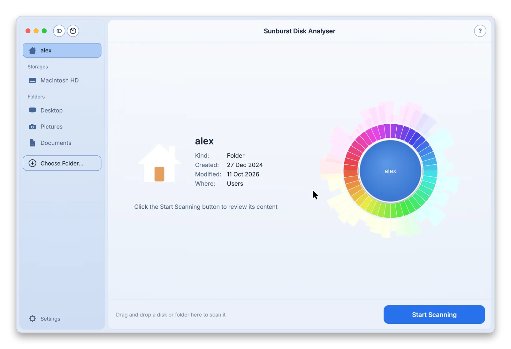
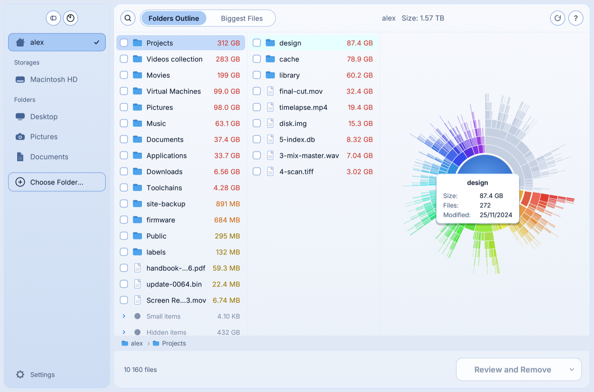
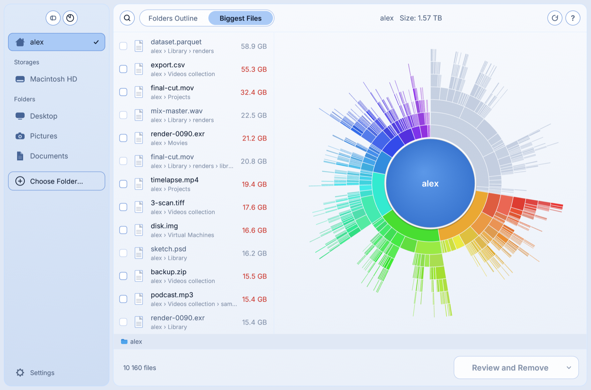
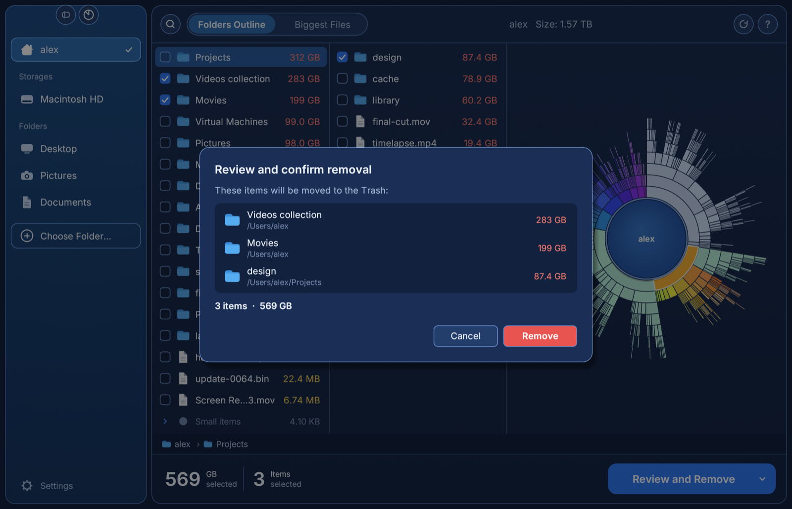
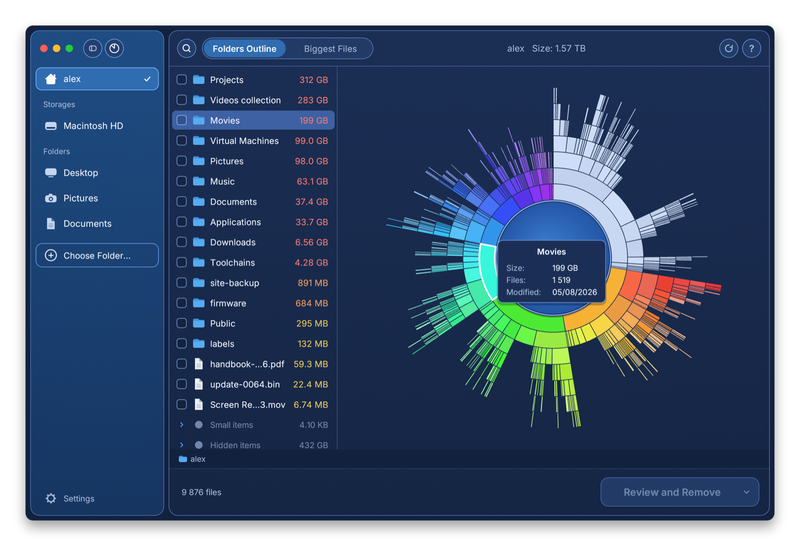

# Sunburst Disk Analyser

See what is filling up your disks. Sunburst Disk Analyser scans a disk or a folder, shows it as an interactive sunburst chart next to a size-sorted outline, and lets you move what you no longer need to the Trash, or move or copy it elsewhere.

One native binary per platform, for **macOS**, **Windows** and **Linux**. No installer, no account, no telemetry. The only network request is an update check at launch, which can be turned off.

<picture>
  <source media="(prefers-reduced-motion: reduce)" srcset="docs/screenshots/demo-still.png">
  
</picture>

| Folders outline | Biggest files |
| --- | --- |
|  |  |

| Review before removing | Dark appearance |
| --- | --- |
|  |  |

The animation and the screenshots show built-in sample data (`--demo`), not a real disk; the scan in the animation is sped up.

## Features

- **Fast parallel scan** with live results while it runs; stop it at any time. A 74 GB folder with about 590,000 files took 2.5 s on an Apple Silicon laptop SSD.
- **Sunburst chart**: one ring per folder level, centred on the folder that holds the selection; hover a segment for its size, file count and date, click it to select it, click the centre to go back up.
- **Folders Outline**: size-sorted columns, as in a column file browser; click a folder to open it in the next column, click a file for a preview pane with a thumbnail (pictures everywhere, videos and PDFs on macOS) and double-click it to open it. Scroll sideways to see the earlier columns; at their edge a two-finger swipe goes back or forward, as do the side buttons of a mouse and ⌘[ / ⌘] (Ctrl on Windows and Linux). The arrow keys walk the columns. Tiny and hidden items are grouped so the big ones stand out.
- **Biggest Files**: the largest files of the whole scan in one list.
- **Search by name** in the scanned items.
- **Select, review, then act**: tick items, check the list, then move them to the Trash, or move or copy them to another folder. Nothing is deleted permanently and nothing is overwritten.
- **Whole disks**: free space and space the scan could not attribute are shown next to your files.
- Favourite folders, drag and drop of folders onto the window, CSV report export, show in Finder / Explorer / file manager, Quick Look (macOS), copy path.
- Dark, light or automatic appearance. English, French, German, Spanish, Italian, Russian, Ukrainian and Simplified Chinese.

## Download

Get the file for your system from the [latest release](https://github.com/tmanaud/sunburst-disk-analyser/releases/latest).

| System | File | First launch |
| --- | --- | --- |
| macOS 11+ (Apple Silicon and Intel) | `…-macos-universal.dmg` | Open the disk image and drag the app to Applications. The app is not notarised by Apple: the first time, right-click it and choose **Open**, or allow it in System Settings → Privacy & Security. |
| Windows 10/11 x64 | `…-windows-x64.zip` | Unzip and run `Sunburst Disk Analyser.exe`. SmartScreen may warn about an unknown publisher: **More info → Run anyway**. |
| Linux x86_64 | `…-linux-x86_64.AppImage` or `.tar.gz` | `chmod +x` the AppImage and run it. Needs glibc 2.35+ and OpenGL. The folder picker uses the desktop portal (`xdg-desktop-portal`). The `.tar.gz` holds the bare binary and also needs `libxkbcommon` and, on X11, `libxkbcommon-x11`. |

`SHA256SUMS.txt` in each release lists the checksums.

### Updates

At launch the app asks GitHub for the latest release (one request to `api.github.com`; GitHub sees your IP address and the app version, nothing about your disks or files is sent). When a newer version exists, a dialog offers to download it, open the release page, or skip that version. **Check for Updates…** is in the app menu on macOS and in the Help menu elsewhere; the check at launch can be turned off in Settings.

The download goes to your Downloads folder and is checked against the release's `SHA256SUMS.txt`. The app never replaces itself: quit it and swap in the new version. On macOS the app is not signed with a Developer ID, so the new copy may have to be granted Full Disk Access again.

### Disk access on macOS

macOS asks before an app may read Desktop, Documents, Downloads and removable disks. To measure every folder, including Mail and other protected data, add the app in System Settings → Privacy & Security → **Full Disk Access**. Folders that could not be read are counted and reported after the scan.

## Using it

1. Pick your home folder, a disk or a folder on the left, or drop a folder on the window.
2. Click **Start Scanning**.
3. Explore with the outline and the chart. Right-click any item for more actions.
4. Tick what you want to get rid of and click **Review and Remove**. The arrow next to the button switches to **Move** or **Copy**.

From a terminal:

```
sunburst-disk-analyser [FOLDER]        scan a folder right away
sunburst-disk-analyser --lang fr       force a language (en fr de es it ru uk zh)
sunburst-disk-analyser --theme light   force an appearance
sunburst-disk-analyser --demo          show sample data
```

## How sizes are measured

- **macOS and Linux**: space allocated on disk, so sparse files and iCloud files that are not downloaded count for what they really use. A file with several hard links is counted once. The scan stays on the scanned file system and does not follow symbolic links.
- **Windows**: file length; OneDrive online-only files count as zero. Junctions and symbolic links are not followed.
- Scanning never downloads cloud-only files.
- A scan keeps at most 40 million items, and 4 million per folder; beyond that the folder is flagged as partly unread rather than exhausting memory.
- On APFS, clones and snapshots share blocks, so the sum of your files can differ from what the system reports as used. When a whole disk is scanned, the difference appears as **Other used space**.

## Safety

- Remove means **move to the Trash / Recycle Bin**. Space is freed when you empty it. Where there is no Trash to move to, the item stays in place and the app says so; it never deletes for good instead:
  - **Linux**: an item goes to the Trash of its own volume (your home Trash, or the volume's `.Trash-<uid>` folder), with a rename. If that folder cannot be used, for instance on a share whose root you cannot write to, the removal is refused.
  - **Windows**: only internal drives have a Recycle Bin. Removal is refused on network shares and removable drives, where Windows would delete permanently.
- Volume roots, your home folder, its standard folders and operating system folders cannot be selected. Hidden items are protected until you allow them in Settings. Other volumes mounted inside the scanned folder and folders that could not be read are listed but cannot be selected, since the scan does not know what they contain.
- Every item is checked again right before it is touched, against what the scan recorded and against what you reviewed: a file must be the same file with the same size and date, a folder must be the same folder (on Windows a folder is matched by name only). An item that disappeared, was replaced or, for a file, was modified in between is skipped and reported; scan again to act on it. A folder is handled with everything it contains at that moment: files added to it after the scan go with it.
- Move and copy never overwrite: on a name clash the new item gets a numbered name. On file systems without an atomic "rename unless it exists" (FAT, exFAT, some network shares) the name is reserved first, so the guarantee holds there too.
- A copy is built in a private folder inside the destination and only appears under its name once complete. Files keep restricted permissions from the first byte. A copy that fails or is stopped part-way leaves nothing behind, and **Stop** takes effect within the item being copied.
- On macOS and Linux, scans, copies and moves open every folder through its parent and never through a symbolic link, so a folder swapped for a link while the app works cannot redirect it. A copy stays on the volume of the item being copied.
- **Move** works within one volume. To move something to another disk, copy it, check the copy, then remove the original: the app will not delete the source of a copy on its own.
- These checks narrow, but cannot fully close, the window in which another program changes a file between the check and the operation. On Windows, and for the final step of a removal on macOS, items are addressed by path, so that window is wider there.
- The CSV report and the settings file are written aside and renamed into place: an existing file is replaced as a whole or not at all.

## Known limits

- macOS "purgeable" space is not broken out separately.
- Hard links: on macOS and Linux a file with several names is counted under the first name found, the others show as empty; after removing the counted name, scan again for exact figures. On Windows each name is counted.
- Copies carry the file content, permissions and modification date, not extended attributes, resource forks, ACLs or NTFS alternate data streams.
- File icons are generic (folder, file, application), not the per-type system icons.
- Quick Look preview exists only on macOS; other systems open the file with its default application.
- The Windows and Linux builds are produced and unit-tested by CI but have had less hands-on testing than the macOS build.

## Build from source

Requires a recent stable [Rust](https://rustup.rs) toolchain.

```
cargo run --release
```

Packaged builds: `packaging/build-macos.sh`, `packaging/build-linux.sh`, `packaging/build-windows.ps1`. On Linux install `libxkbcommon-dev libwayland-dev libx11-dev libxcb1-dev libgl1-mesa-dev` (or your distribution's equivalents) first.

The screenshots and the animation are rendered by the app itself from the sample data: `scripts/screenshots.sh` refreshes them all (macOS, needs `ffmpeg`). `scripts/release.sh <version>` refreshes them, runs the tests, then commits, tags and pushes a release.

## Credits

Written in Rust with [egui](https://github.com/emilk/egui). Interface font: [Inter](https://rsms.me/inter/) (SIL Open Font License).

The film picture in the animation is a resized frame of [Big Buck Bunny](https://peach.blender.org/), © 2008 Blender Foundation, [CC BY 3.0](https://creativecommons.org/licenses/by/3.0/).

The workflow is inspired by Nektony's Disk Space Analyzer for macOS. This is an independent project with its own code, name and artwork; it is not affiliated with or endorsed by Nektony.

## License

[MIT](LICENSE)
