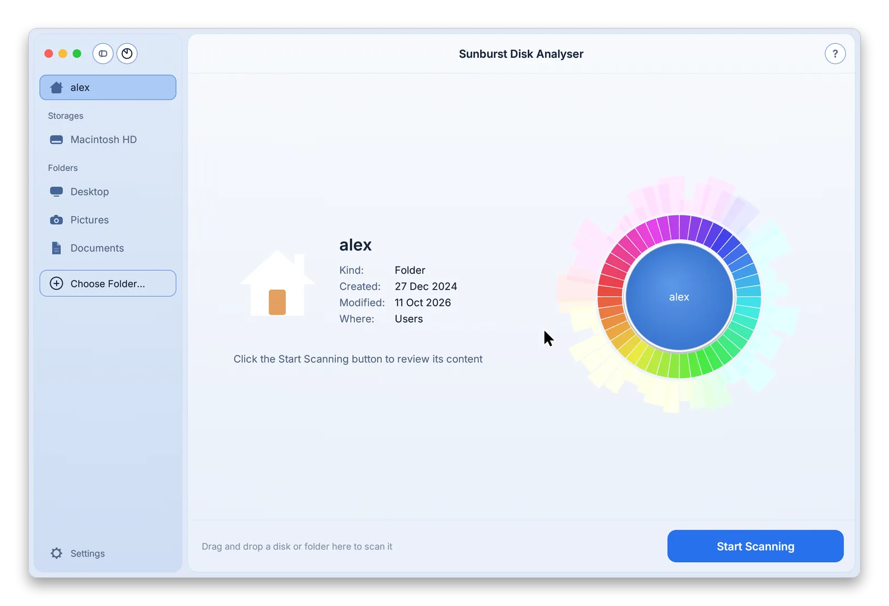
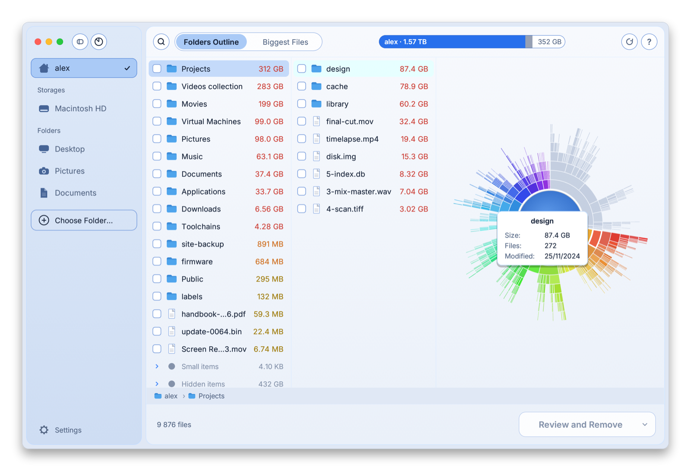
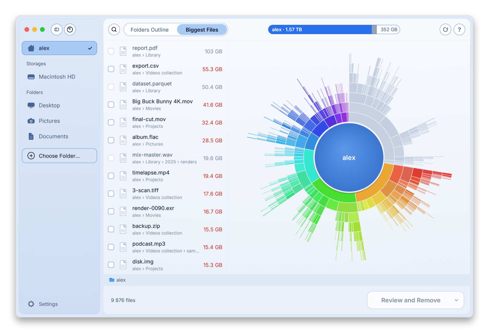
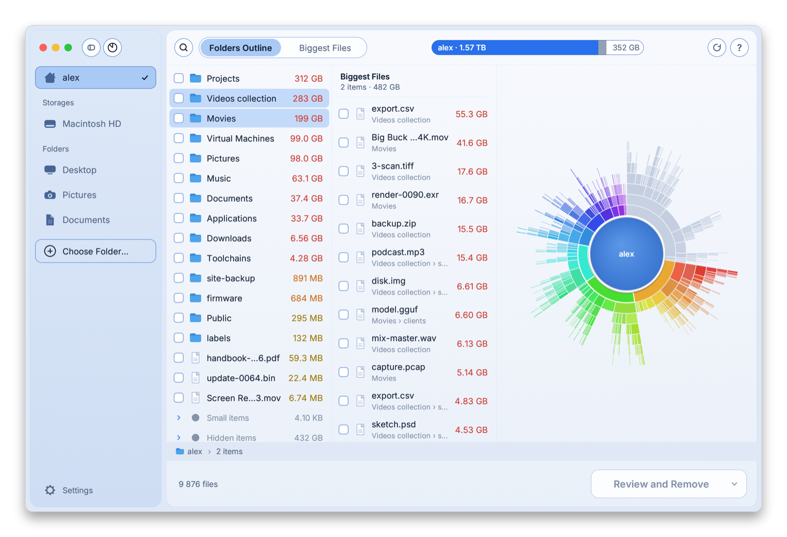
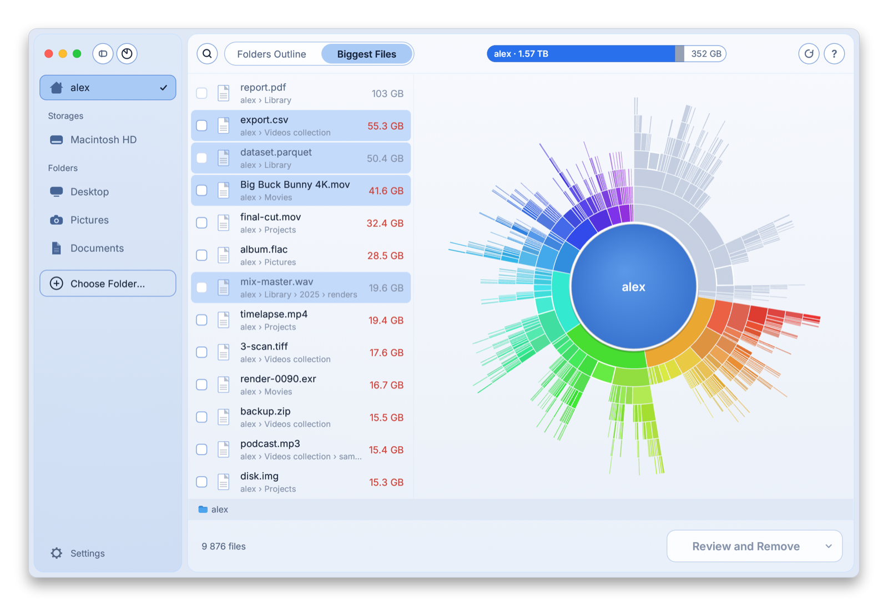
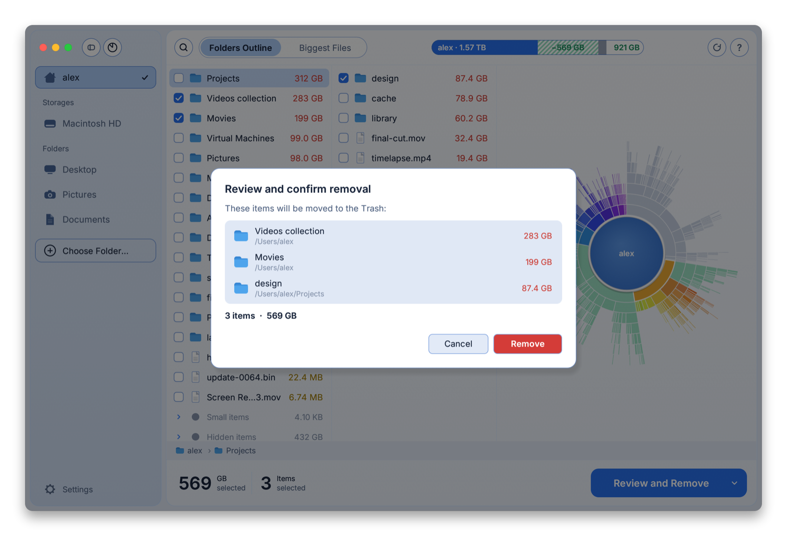
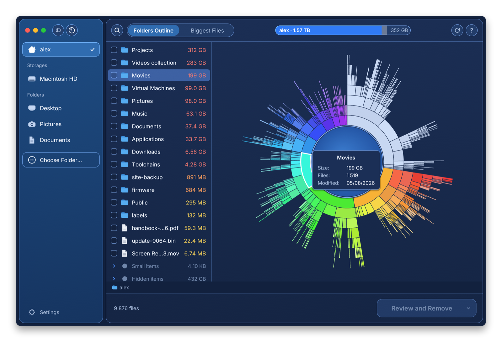

# Sunburst Disk Analyser

Find what takes up disk space. Explore a sunburst chart, size-sorted folders and your biggest files.

macOS, Windows and Linux. No account, no telemetry.

<picture>
  <source media="(prefers-reduced-motion: reduce)" srcset="docs/screenshots/demo-still.png">
  
</picture>

Animation and screenshots use demo data. The animated scan is sped up.

## Download

| System | Download 1.1.0 | First launch |
| --- | --- | --- |
| macOS 11+ · Intel / Apple Silicon | [DMG](https://github.com/tmanaud/sunburst-disk-analyser/releases/download/v1.1.0/Sunburst-Disk-Analyser-1.1.0-macos-universal.dmg) | Drag the app to Applications. Not notarised: open it once, then click **Open Anyway** in System Settings → Privacy & Security. |
| Windows 10/11 · x64 | [ZIP](https://github.com/tmanaud/sunburst-disk-analyser/releases/download/v1.1.0/Sunburst-Disk-Analyser-1.1.0-windows-x64.zip) | Unzip and run **Sunburst Disk Analyser.exe**. SmartScreen: **More info → Run anyway**. |
| Linux · x86_64 | [AppImage](https://github.com/tmanaud/sunburst-disk-analyser/releases/download/v1.1.0/Sunburst-Disk-Analyser-1.1.0-linux-x86_64.AppImage) | `chmod +x` the AppImage, then run it. Needs glibc 2.35+ and OpenGL. |

macOS: allow **Full Disk Access** in System Settings → Privacy & Security for complete results.

[All releases and checksums](https://github.com/tmanaud/sunburst-disk-analyser/releases)

## Use

1. Choose a disk or folder. Click **Start Scanning**.
2. Explore the chart and folders, or search.
3. Tick items. Click **Review and Remove**. The arrow offers **Move** or **Copy**.

Remove sends items to the **Trash / Recycle Bin** and never overwrites anything. Empty the Trash to free the space.

The only automatic network request is an update check at launch. Turn it off in **Settings**.

## Screenshots

| Folders outline | Biggest files |
| --- | --- |
|  |  |

| Several folders at once | Several files at once |
| --- | --- |
|  |  |

| Review before removing | Dark appearance |
| --- | --- |
|  |  |

[Controls, sizes, safety and limits](docs/DETAILS.md)

## Build

Install stable [Rust](https://rustup.rs). On Linux, also install `libxkbcommon-dev libwayland-dev libx11-dev libxcb1-dev libgl1-mesa-dev` or your distribution's equivalents.

```sh
cargo run --release
```

`scripts/screenshots.sh` renders the pictures (macOS, ffmpeg); `scripts/release.sh <version>` publishes a release.

## Credits

Rust and [egui](https://github.com/emilk/egui). [Inter](https://rsms.me/inter/) font: SIL Open Font License.

Fully written with AI coding assistants (Claude, with reviews by GPT), directed and tested by the author.

Film picture: resized frame of [Big Buck Bunny](https://peach.blender.org/), © 2008 Blender Foundation, [CC BY 3.0](https://creativecommons.org/licenses/by/3.0/).

Independent project, inspired by Nektony's Disk Space Analyzer. Not affiliated with or endorsed by Nektony.


